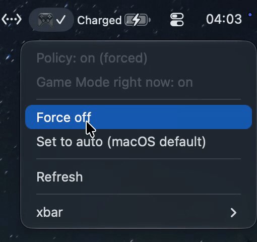

<div align="center">

# xbar-game-mode-toggle

Switch macOS Game Mode between auto, on and off from your menu bar.


<br>



</div>

## Why

macOS turns on Game Mode by itself whenever a game goes fullscreen, and System Settings has no switch for it. While it is on, everything except the game runs at background priority, which slows down builds and anything else you leave running. This plugin shows the current policy and lets you change it with one click.

## What it shows

| Icon | Policy |
| :---: | --- |
| `🎮` | Auto, the macOS default. Game Mode turns on for fullscreen games. |
| `🎮✓` | Forced on |
| `🎮✕` | Forced off |

The menu offers **Force on**, **Force off** and **Set to auto**, minus whichever one is already active. The plugin refreshes after every change and every 30 seconds.

## Requirements

- macOS 14 Sonoma or later
- [xbar](https://xbarapp.com)
- Xcode, which ships Apple's `gamepolicyctl`. The plugin finds it through `xcrun` or in `/Applications/Xcode*.app`. No sudo needed.

## Install

```sh
git clone https://github.com/ArchitektApx/xbar-game-mode-toggle.git
ln -s "$PWD/xbar-game-mode-toggle/gamemode.30s.sh" \
  ~/Library/Application\ Support/xbar/plugins/gamemode.30s.sh
```

Refresh xbar afterwards. The `30s` in the filename sets the refresh interval.

## Without the plugin

```sh
GPC=$(xcrun -f gamepolicyctl)
$GPC game-mode status
$GPC game-mode set off    # or auto / on
```
